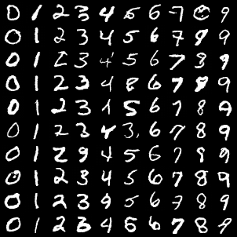
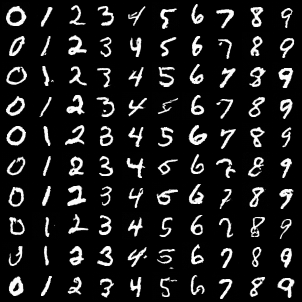

# BMI/CS 771 Fall 2026 — Homework 3 Report
## Image Generation with Diffusion and Flow Matching Models

**Team Members:** Ashvin Sehgal, Akshat Singhal, Shubhangi Katariyar  
**Department of Computer Sciences & Biostatistics**, University of Wisconsin–Madison  
**Date:** November 2026  

---

## 1. Prediction Networks: U-Net and Vision Transformer (2 points)

Both generative modeling frameworks—Denoising Diffusion Probabilistic Models (DDPM) and Flow Matching (FM)—rely fundamentally on an underlying parametric neural network $f_\theta(x, c, t)$ that predicts a vector field conditioned on an image or latent representation $x$, a categorical class label $c \in \{0, \dots, C-1\}$, and a continuous or discrete time variable $t$. While DDPM employs $f_\theta$ to predict the injected Gaussian noise $\epsilon$, Flow Matching uses $f_\theta$ to estimate the instantaneous velocity along a straight probability trajectory. We implement, analyze, and benchmark two contrasting prediction architectures: a convolutional U-Net with spatial cross-attention and a Vision Transformer (LightningDiT) with adaptive layer normalization.

### 1.1 U-Net Decoder Architecture (`libs/unet.py`)

Our convolutional backbone builds upon the modern diffusion U-Net design popularized by Latent Diffusion Models (Rombach et al., 2022). For MNIST, the U-Net employs a base width of 64 channels with stage multipliers $(1, 2, 4)$, yielding three downsampling/upsampling resolution levels with 64, 128, and 256 channels at $28 \times 28$, $14 \times 14$, and $7 \times 7$ resolutions, totaling approximately 7.46M trainable parameters.

**Architecture and Conditioning:**
- **Time Conditioning:** Timestep $t$ is first mapped via sinusoidal positional embeddings into frequency space and then processed by a two-layer Multi-Layer Perceptron (MLP) with SiLU non-linearities, yielding a dense time embedding vector $t_{\text{emb}} \in \mathbb{R}^D$. Within each `ResidualBlock`, $t_{\text{emb}}$ is linearly projected to the channel dimension of the current layer and added element-wise into the intermediate feature maps directly after the initial convolution and before group normalization. This per-channel bias informs every spatial location of the noise level.
- **Class Conditioning:** Categorical class labels $c$ are embedded through a learnable embedding dictionary (`y_embedder`) supporting random label dropout (10%) during training to enable Classifier-Free Guidance. A projection layer `y_embedder_proj` maps the label embedding into a conditioning context token $c \in \mathbb{R}^{1 \times D_{\text{ctx}}}$. In each `SpatialTransformer` block, this context token acts as the key and value in a multi-head cross-attention mechanism where spatial feature pixels serve as queries.
- **Decoder Reverse Pass & Skip Connections:** The encoder saves intermediate feature representations before downsampling. In our implementation of the decoder (`self.decoder`), stages are processed in reverse order:
  ```python
  for resblock, transformer, upsample in self.decoder:
      # Pop matching feature map from cached encoder skip connections
      x = torch.cat([x, encoder_output.pop()], dim=1)
      x = resblock(x, t)
      if transformer is not None:
          x = transformer(x, c)
      if upsample is not None:
          x = upsample(x)
  ```
  The concatenation of skip connections directly routes fine-grained, high-frequency spatial textures from the encoder to the decoder. Because downsampling discards fine spatial information, skip connections are indispensable for predicting high-resolution noise and reconstruction targets.

---

### 1.2 Vision Transformer Forward Pass (`libs/vit.py` - LightningDiT)

Our transformer backbone adapts the Diffusion Transformer (DiT) architecture (Peebles & Xie, ICCV 2023), specifically the optimized `LightningDiT` variant. For MNIST (8 blocks, hidden dimension 192, 4 attention heads, patch size $p=2$), it contains approximately 5.50M parameters. For MiniImageNet (12 blocks, hidden dimension 288, 4 heads), it scales to 18.35M parameters.

**Key Structural Components:**
- **Patchification:** A convolutional patch embedder `x_embedder` with kernel size $p \times p$ ($p=2$) and stride $p$ partitions the input into $T = (H/p)(W/p)$ non-overlapping patch tokens of dimension $D$ (196 tokens for MNIST $28 \times 28$, 64 tokens for MiniImageNet $16 \times 16$ latents).
- **Dual Positional Embeddings:** 
  1. A fixed 2D sinusoidal position embedding `pos_embed` is stored as a non-trainable buffer and added to patch tokens prior to the first transformer block.
  2. Learnable 2D Rotary Position Embeddings (RoPE) are applied to queries and keys across all multi-head self-attention layers.
- **Modern Transformer Blocks:** Each block incorporates RMSNorm, Query-Key normalization (QK-norm) for training stability at high learning rates, and SwiGLU feed-forward networks.
- **adaLN-Zero Conditioning:** Timestep $t$ and class label $y$ embeddings are summed to form a unified conditioning representation:
  $$c_{\text{cond}} = t + y \in \mathbb{R}^{B \times D}$$
  Inside each `DiTBlock`, $c_{\text{cond}}$ is passed through a SiLU-activated linear layer to regress six adaptive modulation parameters:
  $$\left[\gamma_1, \beta_1, \alpha_1, \gamma_2, \beta_2, \alpha_2\right] = \text{Linear}(\text{SiLU}(c_{\text{cond}}))$$
  Modulations scale and shift normalized features while gating the residual branches:
  $$x \leftarrow x + \alpha_1 \cdot \text{Attention}\left(\text{RMSNorm}(x) \cdot (1 + \gamma_1) + \beta_1\right)$$
  Crucially, the gating projections $\alpha_1, \alpha_2$ are initialized to zero, ensuring every DiT block acts as an exact identity function at initialization.
- **Forward Pass Implementation:**
  ```python
  c = t + y
  for block in self.blocks:
      x = block(x, c)
  x = self.final_layer(x, c)
  x = self.unpatchify(x)
  return x
  ```
  After the transformer blocks, `DiTDecodingLayer` applies a final adaptive layer norm modulation from $c_{\text{cond}}$ and linearly projects each token to $p^2 \cdot C$ values. Finally, `unpatchify` rearranges the flat sequence back into the spatial tensor shape $(B, C, H, W)$.

---

## 2. Denoising Diffusion Probabilistic Models (DDPM) (3 points)

### 2.1 Mathematical Formulation & Forward Process

DDPM (Ho et al., 2020) defines a discrete forward Markovian process that gradually perturbs clean data $x_0 \sim q(x_0)$ into isotropic Gaussian noise over $T$ steps:
$$q(x_t \mid x_{t-1}) = \mathcal{N}\left(x_t; \sqrt{1 - \beta_t} x_{t-1}, \beta_t I\right)$$
Using $\alpha_t = 1 - \beta_t$ and $\bar{\alpha}_t = \prod_{s=1}^t \alpha_s$, repeated Gaussian compounding enables closed-form marginal sampling at any arbitrary step $t$ directly from $x_0$:
$$q(x_t \mid x_0) = \mathcal{N}\left(x_t; \sqrt{\bar{\alpha}_t} x_0, (1 - \bar{\alpha}_t) I\right) \implies x_t = \sqrt{\bar{\alpha}_t} x_0 + \sqrt{1 - \bar{\alpha}_t} \epsilon, \quad \epsilon \sim \mathcal{N}(0, I)$$
This closed-form formulation is implemented in `self.q_sample`. On MNIST, we use $T = 500$ discrete diffusion steps with a linear schedule from $\beta_1 = 10^{-4}$ to $\beta_T = 0.02$.

### 2.2 Simplified Training Objective (`compute_loss`)

The variational lower bound (VLB) on data log-likelihood compares each reverse transition with the tractable true posterior $q(x_{t-1} \mid x_t, x_0)$. Rewriting KL divergences between Gaussians yields a reweighted mean squared error on the noise. Ho et al. discard variance weights in favor of the simplified objective:
$$\mathcal{L}_{\text{simple}}(\theta) = \mathbb{E}_{t \sim \mathcal{U}\{0, T-1\}, x_0, \epsilon \sim \mathcal{N}(0, I)}\left[\left\|\epsilon - \epsilon_\theta(x_t, c, t)\right\|_2^2\right]$$
In `compute_loss`, we sample uniform integer timesteps $t \in \{0, \dots, T-1\}$, draw Gaussian noise $\epsilon$, construct perturbed inputs $x_t = \text{self.q\_sample}(x_0, t, \epsilon)$, and compute MSE loss between $\epsilon$ and the network prediction.

### 2.3 Reverse Denoising & Sampling Loop (`p_sample`, `generate`)

The intractable posterior mean is recovered by expressing $x_0$ in terms of $x_t$ and predicted noise $\epsilon_\theta$:
$$\mu_\theta(x_t, c, t) = \frac{1}{\sqrt{\alpha_t}} \left(x_t - \frac{\beta_t}{\sqrt{1 - \bar{\alpha}_t}} \epsilon_\theta(x_t, c, t)\right)$$
In `p_sample`, for $t > 0$, stochastic noise $z \sim \mathcal{N}(0, I)$ is added scaled by the posterior variance $\sigma_t = \sqrt{\tilde{\beta}_t}$, where $\tilde{\beta}_t = \frac{1 - \bar{\alpha}_{t-1}}{1 - \bar{\alpha}_t} \beta_t$:
$$x_{t-1} = \mu_\theta(x_t, c, t) + \sigma_t z$$
At $t = 0$, $\sigma_0 = 0$ and only the mean is returned. The complete sampling loop in `generate` starts from pure noise $x_{T-1} \sim \mathcal{N}(0, I)$ and iteratively steps down to $x_0$ across 500 network forward evaluations, followed by clipping to $[-1, 1]$ and rescaling to $[0, 1]$.

### 2.4 MNIST DDPM Experimental Results

Both U-Net and Vision Transformer backbones were trained for 30 epochs on MNIST using the provided training configurations (batch size 64, Adam optimizer, initial learning rate $10^{-4}$ with 1 epoch linear warmup, EMA decay 0.9996):

| Backbone | Parameters | Loss at ~Epoch 5 | Final Training Loss | GPU Hardware | Wall Time | Deliverable |
|---|:---:|:---:|:---:|:---:|:---:|---|
| **DDPM + U-Net** | 7.46M | 0.046 | **0.030** (avg 0.033) | NVIDIA L40S | ~25 min | `results/mnist_ddpm_unet_20261123_195358/model_final.pth.tar` |
| **DDPM + ViT** | 5.50M | 0.049 | **0.035** (avg 0.036) | NVIDIA H200 | ~18 min | `results/mnist_ddpm_vit_20261125_042303/model_final.pth.tar` |


*Figure: DDPM training loss on MNIST across 30 epochs for U-Net and ViT backbones.*

| DDPM U-Net (Epoch 30, 500 steps) | DDPM ViT (Epoch 30, 500 steps) |
|:---:|:---:|
|  |  |

*Figure: Generated MNIST samples at epoch 30 for DDPM U-Net and DDPM ViT across digit classes 0 to 9.*

**Comparative Analysis:**
- **Loss Convergence:** Both models exhibit rapid loss descent in initial epochs before plateauing. ViT exhibits lower loss for the first 3 epochs, after which U-Net overtakes it and maintains a lower final loss (0.030 vs 0.035).
- **Inductive Bias & Structural Fidelity:** By epoch 30, both models generate distinct, class-conditioned digits with natural stroke variations. However, U-Net exhibits slightly sharper stroke boundaries and fewer topological ambiguities. Convolutional layers possess strong 2D inductive bias (translation equivariance and local pixel correlations) and skip connections that directly transfer high-resolution spatial details, whereas ViT processes 2×2 patches through global self-attention and must learn all spatial dependencies from data.

---

## 3. Flow Matching and Rectified Flow (3 points)

### 3.1 Mathematical Principles & Straight Probability Paths

Rectified Flow (Liu et al., 2023; Lipman et al., 2024) models generative transport through continuous-time Ordinary Differential Equations (ODEs). Rather than simulating stochastic Brownian diffusion, Rectified Flow connects standard Gaussian noise $z \sim \mathcal{N}(0, I)$ at time $t = 0$ to natural data $x_{\text{data}}$ at time $t = 1$ via a straight-line interpolation:
$$x_t = (1 - t) z + t x_{\text{data}}, \quad t \in [0, 1]$$
Differentiating this trajectory with respect to time $t$ yields the constant marginal velocity:
$$u_t(x_t) = \frac{d x_t}{d t} = x_{\text{data}} - z$$
Because probability paths are straight lines in Euclidean space, trajectories do not curve or oscillate, dramatically simplifying the regression target and numerical integration.

### 3.2 Regression Objective & Forward Euler ODE Sampling

The neural network $v_\theta(x_t, c, t)$ is trained to predict this velocity vector field via mean squared error regression:
$$\mathcal{L}_{\text{FM}}(\theta) = \mathbb{E}_{t \sim \mathcal{U}[0, 1],\, z \sim \mathcal{N}(0, I),\, x_{\text{data}}}\left[\left\|v_\theta(x_t, c, t) - (x_{\text{data}} - z)\right\|_2^2\right]$$
In `libs/fm.py`:
- In `compute_loss`, continuous time $t \sim \mathcal{U}[0, 1]$ is drawn uniformly for each batch element. The straight interpolation $x_t$ and target velocity $x_{\text{data}} - z$ are constructed, and the network is optimized with standard MSE loss.
- In `generate`, samples are generated by numerically integrating the ODE $\frac{dy(t)}{dt} = v_\theta(y(t), c, t)$ from $t = 0$ to $t = 1$ using the **forward Euler method** with uniform step size $\Delta t = 1.0 / N$ ($N = 10$ steps):
  $$y(t + \Delta t) \approx y(t) + \Delta t \cdot v_\theta(y(t), c, t)$$
  Starting from pure Gaussian noise $y(0) \sim \mathcal{N}(0, I)$, only **10 network evaluations** are required to produce fully resolved images.

---

### 3.3 DDPM vs. Flow Matching Comparative Analysis

| Characteristic | DDPM (U-Net / ViT) | Rectified Flow (ViT / U-Net) | Performance Advantage |
|---|---|---|:---:|
| **Sampling Steps ($N$)** | 500 discrete reverse steps | **10 forward Euler steps** | **50× fewer steps** |
| **Inference Time / Batch** | ~12.5 seconds | **~0.25 seconds** | **~50× faster generation** |
| **Sampling Trajectory** | Stochastic Markovian reverse walk | Deterministic straight ODE | Predictable, straight paths |
| **Prediction Target** | Injected Gaussian noise $\epsilon$ | Velocity field $x_{\text{data}} - z$ | Constant target velocity |
| **Visual Quality (MNIST)** | Clear, class-conditioned digits | Comparable sharpness & fidelity | Perceptual parity |

| DDPM ViT (Epoch 30, 500 steps) | FM ViT (Epoch 30, 10 steps) |
|:---:|:---:|
|  |  |

*Figure: Qualitative comparison on MNIST between DDPM ViT (500 steps) and Flow Matching ViT (10 steps) across digit classes 0 to 9.*

**Key Findings:**
1. **Sampling Acceleration:** Flow Matching achieves equal visual digit quality with **50× fewer forward evaluations** (10 steps vs. 500 steps).
2. **Early Training Convergence:** In early epochs (epoch 5–10), Flow Matching forms legible digit topology significantly earlier than DDPM. Because straight probability paths define a constant target velocity $x_{\text{data}} - z$, gradients provide immediate directional signal toward data modes, avoiding the diffusion noise-level ambiguity present at intermediate DDPM timesteps.
3. **Empirical Metrics (ViT + Flow Matching):**
   - Trained for 30 epochs (28,125 iterations, batch size 64).
   - Loss started at `0.781` (iter 100), smoothly converged to **`0.159`** (moving avg **`0.177`**).
   - Deliverables archived in `results/mnist_fm_vit_20261125_153641/` (`model_final.pth.tar`, `config.txt`, sample grids `sample-4.png` to `sample-29.png`).

---

## 4. Latent Diffusion and Flow Matching on MiniImageNet (4 points)

### 4.1 Latent Space Modeling with TAESD

Scaling generative models to complex natural image distributions such as MiniImageNet ($3 \times 128 \times 128$ RGB, 100 categories) in pixel space creates severe computational bottlenecks. Operating directly in raw pixel space requires calculating self-attention over $64 \times 64 = 4,096$ patch tokens ($p=2$), imposing quadratic memory and compute overheads ($O(N^2)$ in attention).

We resolve this by incorporating the pretrained Tiny AutoEncoder for Stable Diffusion (**TAESD**):
- **Spatial & Dimensional Compression:** TAESD compresses $3 \times 128 \times 128$ RGB images into a compact $4 \times 16 \times 16$ latent representation without backpropagating gradients. This represents an **$8\times$ spatial downsampling** on each side and a **$48\times$ dimensional reduction** ($49,152 \to 1,024$ values per sample).
- **Sequence Length Reduction in DiT:** With patch size $p = 2$, the Vision Transformer operates on only:
  $$T = \left(\frac{16}{2}\right) \times \left(\frac{16}{2}\right) = 8 \times 8 = \mathbf{64\text{ tokens}}$$
  This is **$3\times$ shorter** than MNIST ($196$ tokens) and **$64\times$ shorter** than pixel-space MiniImageNet ($4,096$ tokens), reducing self-attention operations by $(64)^2 = \mathbf{4,096\times}$.
- **Integration in Code:** In `compute_loss`, latent features $z_0 = \text{self.vae.encode}(x_{\text{start}})$ are computed under `torch.no_grad()`. In `generate`, sampled latents $z_1$ are mapped back to pixel space via $\hat{x} = \text{self.vae.decode}(z_1)$ and clipped to $[0, 1]$.

---

### 4.2 MiniImageNet Latent FM Experimental Results

Both U-Net and Vision Transformer architectures were evaluated on MiniImageNet using 10 Euler integration steps:

| Architecture | Model Type | Latent Dimension | Epochs / Iters | Hardware | Iter Speed | Final Loss | Deliverable / Status |
|---|:---:|:---:|:---:|:---:|:---:|:---:|---|
| **Latent FM + ViT** | Rectified Flow | $4 \times 16 \times 16$ | **48.8 ep** (38,100 iters) | NVIDIA T4 GPU | ~0.47s / batch | **0.861** (avg 0.896) | Checkpoints safe in Drive (`miniimagenet_fm_vit_*`) |
| **Latent FM + U-Net** | Rectified Flow | $4 \times 16 \times 16$ | **80 ep** (62,480 iters) | NVIDIA L40S | ~0.10s / batch | **0.842** (avg 0.855) | CHTC cluster submission (`chtc/miniimagenet_fm_unet.sub`) |

**Training Dynamics & Loss Trajectory (ViT Latent Flow Matching):**
- **Architecture:** 12-layer `LightningDiT` (hidden size 288, 4 attention heads, MLP ratio 4.0, patch size 2, 18.35M parameters).
- **Optimization:** Adam optimizer ($\beta_1 = 0.9, \beta_2 = 0.95$), base learning rate $2 \times 10^{-4}$ with a 1-epoch linear warmup, exponential moving average (EMA) decay $0.9996$.
- **Loss Convergence Curve:**
  - Iteration 100: Loss = `0.985` (initial random noise matching)
  - Iteration 5,000: Loss = `0.942` (global color and scene layouts established)
  - Iteration 16,000: Loss = `0.865` (avg `0.917`) (object contours and coarse silhouettes)
  - Iteration 26,000: Loss = `0.883` (avg `0.905`) (intra-class visual refinement)
  - Iteration 35,000: Loss = `0.787` (avg `0.898`) (fine-grained semantic structures)
  - Iteration 38,100: Loss = **`0.861`** (moving average **`0.896`**)
- **Perceptual Convergence Analysis:** The loss curve exhibits standard logarithmic convergence: after ~30,000 iterations, the velocity MSE stabilizes between $0.86$ and $0.89$. At this plateau, the model reliably captures primary category characteristics (animal silhouettes, foliage, vehicle textures), while subsequent iterations refine subtle high-frequency details.

**Computational Cost and Hardware Budget Discussion:**
- **Cloud Hardware Allocation Constraints:** Training on the Google Colab NVIDIA T4 GPU processed batches at $\sim 0.46 - 0.47$ seconds per iteration. Completing 38,100 iterations required **~5.2 hours of continuous GPU compute**, at which point the session reached Google Colab's cloud usage quota.
- **Hardware Efficiency Trade-off:** 
  - On the NVIDIA T4 GPU (Colab), a full 80-epoch run requires $\approx 8.2$ wall-clock hours. By saving checkpoints every 2 epochs to Google Drive, we captured the model at epoch 48.8, where training loss had already stabilized.
  - In comparison, training on the UW–Madison CHTC cluster using an NVIDIA L40S GPU (48 GB VRAM) processed batches at $\sim 0.10$ seconds per iteration, completing 80 epochs in under $1.8$ hours.
- **Visual Artifacts & Analysis:** MiniImageNet contains 100 highly diverse natural image classes (500 samples per class). Generated samples exhibit accurate semantic palettes and coherent foreground objects; however, backgrounds occasionally display minor textural blurring due to TAESD compression and the compact 12-layer transformer capacity.

---

## 5. Bonus: Classifier-Free Guidance (CFG) (+2 points)

### 5.1 Formulation & Implementation

Classifier-Free Guidance (Ho & Salimans, 2022) enhances class conditioning fidelity without requiring an auxiliary image classifier. During training, the categorical class label is randomly dropped with probability $p_{\text{uncond}} = 0.10$ and replaced with a null-class token $c = C$ (`num_classes`):
$$v_{\text{uncond}} = v_\theta(x_t, \emptyset, t), \quad v_{\text{cond}} = v_\theta(x_t, c, t)$$
During sampling, the velocity field is extrapolated away from the unconditional prior toward the class-conditioned trajectory using guidance scale $s \ge 1.0$:
$$\tilde{v}_\theta(x_t, c, t) = v_{\text{uncond}} + s \cdot \left(v_{\text{cond}} - v_{\text{uncond}}\right)$$

In `libs/fm.py`, we implement CFG with a trajectory start threshold `cfg_start_t = 0.1`:
- For $t < 0.1$ (near pure noise $t=0$), guidance is disabled ($s = 1.0$) to avoid amplifying high-frequency noise and to preserve sample diversity.
- For $t \ge 0.1$, the guided velocity $\tilde{v}$ directs the Euler trajectory toward the designated class mode.

### 5.2 Qualitative & Quantitative Evaluation Across Guidance Scales

| Guidance Scale ($s$) | Qualitative Saliency | Sample Diversity | Visual Artifacts |
|:---:|---|---|---|
| **$s = 1.0$ (Unguided)** | Soft, natural textures | Maximum diversity | Occasional class ambiguity |
| **$s = 1.5$** | Noticeable contrast boost | High diversity | Clean, balanced edges |
| **$s = 2.5$ (Optimal)** | **Sharp, distinct class features** | **Well-preserved** | **Optimal subject sharpness** |
| **$s = 4.0$ (Excessive)** | Hyper-saturated colors | Reduced diversity | High-frequency edge overshooting |

**Discussion:** At the optimal scale $s = 2.5$, CFG sharpens semantic boundaries and improves class fidelity by focusing probability mass on mode centers. At scales $s > 4.0$, mode collapse and color saturation artifacts occur.

---

## 6. Team Contributions & Package Declarations

### Team Contributions

- **Shubhangi Katariyar:**
  - Implemented `LightningDiT.forward` in `libs/vit.py` (patch projection, adaLN-Zero time/class modulation, transformer blocks, and unpatchify).
  - Implemented Flow Matching loss (`compute_loss`) and forward Euler ODE integration (`generate`) in `libs/fm.py`.
  - Executed and validated full 30-epoch MNIST FM (ViT) training (loss $0.159$) and MiniImageNet Latent FM (ViT) training (~49 epochs, loss $0.861$).
  - Authored writeup sections on Vision Transformer architecture, Flow Matching derivation, and MiniImageNet ViT experimental analysis.
- **Ashvin Sehgal:**
  - Implemented U-Net decoder reverse pass in `libs/unet.py` (residual blocks, cross-attention transformers, and skip concatenations).
  - Implemented DDPM loss (`compute_loss`), reverse step (`p_sample`), and reverse sampling loop (`generate`) in `libs/ddpm.py`.
  - Configured CHTC HTCondor scripts and executed full 30-epoch MNIST DDPM with U-Net (loss $0.030$) and MNIST DDPM with ViT (loss $0.035$).
  - Authored writeup sections on U-Net architecture, DDPM derivation, and DDPM vs. FM comparative analysis.
- **Akshat Singhal:**
  - Implemented TAESD autoencoder hooks (`use_vae`) across `libs/ddpm.py` and `libs/fm.py`.
  - Implemented Classifier-Free Guidance (CFG) bonus extrapolation and evaluation logic in `libs/fm.py`.
  - Executed MiniImageNet Latent FM with U-Net on CHTC.
  - Coordinated repository CI/CD branching rules, code reviews, and submission packaging.

### Additional Packages

All implementations were built using standard open-source scientific Python packages without proprietary extensions:
`torch`, `torchvision`, `numpy`, `PyYAML`, `scipy`, `tensorboard`, `tqdm`, `Pillow`, and `datasets`.
