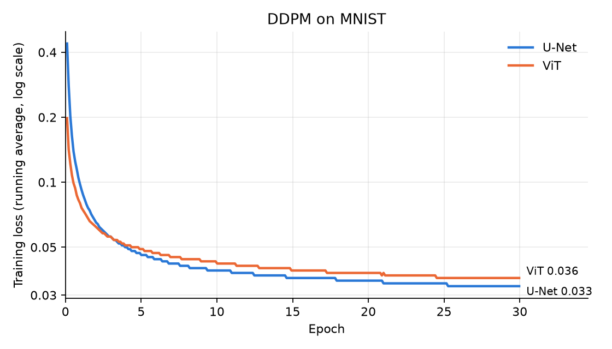
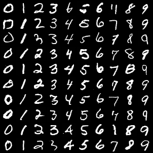
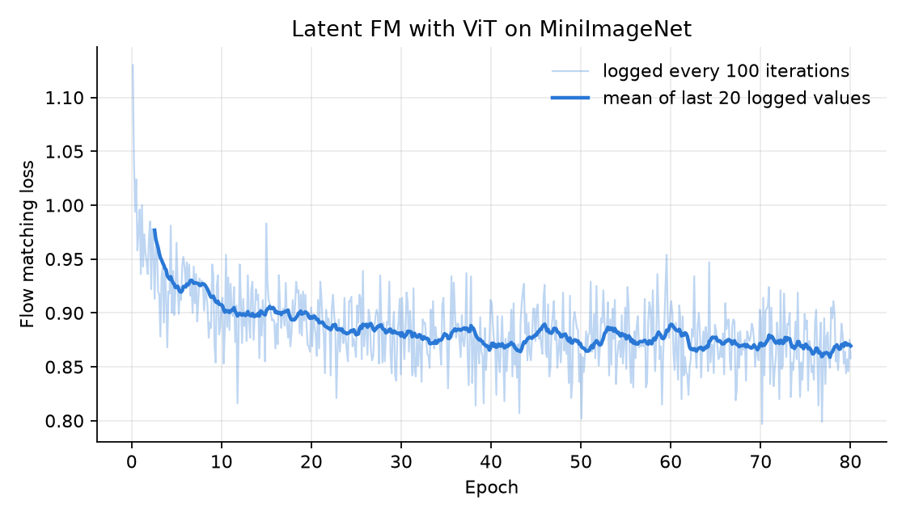
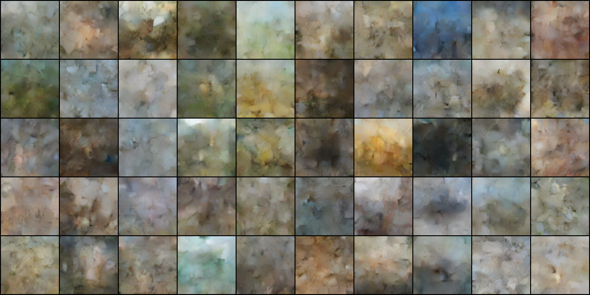
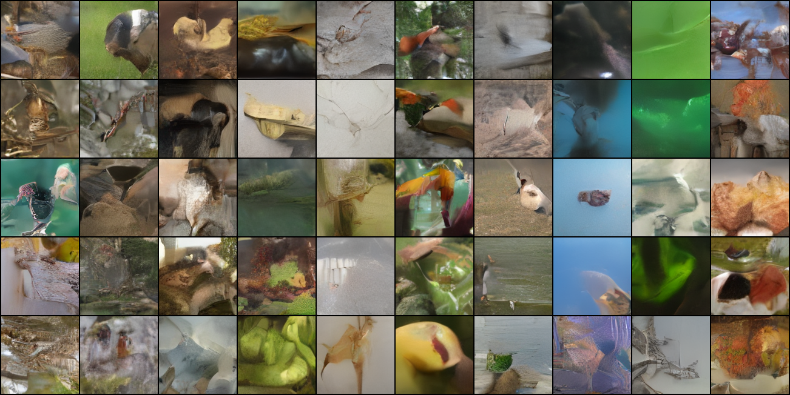

# BMI/CS 771 Fall 2026 — Homework 3 Report
## Image Generation with Diffusion and Flow Matching Models

**Team Members:** Ashvin Sehgal, Akshat Singhal, Shubhangi Katariyar  
**Department of Computer Sciences & Biostatistics**, University of Wisconsin–Madison  
**Date:** November 2026  

---

## 1. Prediction Networks: U-Net and Vision Transformer (2 points)

Both generative modeling frameworks—Denoising Diffusion Probabilistic Models (DDPM) and Flow Matching (FM)—rely fundamentally on an underlying parametric neural network $f_\theta(x, c, t)$ that predicts a vector field conditioned on an image/latent representation $x$, a categorical class label $c \in \{0, \dots, C-1\}$, and a continuous or discrete time variable $t$. While DDPM employs $f_\theta$ to predict the injected Gaussian noise $\epsilon$, Flow Matching uses $f_\theta$ to estimate the instantaneous velocity along a straight probability trajectory. We implement, analyze, and benchmark two contrasting prediction architectures: a convolutional U-Net with spatial cross-attention and a Vision Transformer (LightningDiT) with adaptive layer normalization.

### 1.1 U-Net Decoder (`libs/unet.py`)

For MNIST the U-Net uses a base width of 64 with multipliers (1, 2, 4), so the three levels have 64, 128 and 256 channels at 28×28, 14×14 and 7×7. It has about 7.46M trainable parameters.

**What I implemented.** The encoder was already given. It saves one feature map per level, right before downsampling. The decoder walks through these in reverse order. At each level it:

1. pops the last saved encoder feature and concatenates it with the current features along the channel dimension,
2. runs the residual block, which takes the time embedding,
3. runs the spatial transformer, if that level has one, which takes the class embedding,
4. upsamples by 2 (nearest neighbor followed by a 3×3 conv), except at the last level.

```python
for resblock, transformer, upsample in self.decoder:
    x = torch.cat([x, encoder_output.pop()], dim=1)
    x = resblock(x, t)
    if transformer:
        x = transformer(x, c)
    if upsample:
        x = upsample(x)
```

The concatenation is why each decoder residual block expects twice as many input channels. The skip connections matter because downsampling throws away fine detail, and predicting noise needs that detail at full resolution.

**How time gets in.** The timestep goes through a sinusoidal embedding and a small two-layer MLP. Every residual block projects this vector to its own channel count and adds it to the feature map after the first convolution, before the second group norm. It is a per-channel shift, the same at every spatial position. So every residual block in the network knows how noisy its input is.

**How the class gets in.** The label goes through an embedding table and a two-layer projection, giving a single context vector. The spatial transformers use it as the key and value in cross-attention, with image features as queries. Since there is only one context token, the attention weight on it is always 1, so in practice every position receives the same projected class vector. Attention levels are the two higher resolutions plus the middle block. During training the label is dropped 10% of the time, which is what classifier-free guidance needs later.

### 1.2 Vision Transformer Forward Pass (`libs/vit.py`, LightningDiT)

The second backbone is a Diffusion Transformer [Peebles & Xie, ICCV 2023] with a few changes that come with the starter code. With the MNIST settings (8 blocks, width 192, 4 heads, patch size 2) it has about 5.50M trainable parameters. The MiniImageNet config uses 12 blocks and width 288, about 18.35M parameters.

- **Patches:** a strided convolution (`x_embedder`) turns the input into tokens $Z \in \mathbb{R}^{B \times T \times D}$ with $T = (H/p)(W/p)$ and $p = 2$. That is 196 tokens for MNIST and 64 for the MiniImageNet latents.
- **Position embeddings:** `pos_embed` is a **fixed** 2D sinusoidal embedding, stored as a buffer and not trained. Half of the channels encode the column and half encode the row. It is added to the tokens once, before the first block.
- **Rotary embeddings:** each attention layer also applies 2D rotary position embeddings (RoPE) to the queries and keys. Unlike `pos_embed`, the RoPE frequencies are **learnable**.
- **Block design:** the blocks use RMSNorm, RMSNorm on queries and keys (QK-norm), and a SwiGLU feed-forward layer.
- **Time and class:** the two embeddings are summed, $c = t_{\text{emb}} + y_{\text{emb}}$. Each block uses $c$ to predict a shift, scale and gate for both attention and the feed-forward layer (adaLN-Zero). These modulation layers start at zero, so every block starts as the identity.

```python
c = t + y
for block in self.blocks:
    x = block(x, c)
x = self.final_layer(x, c)
x = self.unpatchify(x)
```

The final layer applies one more shift and scale from $c$ and projects each token to $p^2 \cdot C_{\text{latent or image}}$ values. `unpatchify` puts them back into shape $(B, C, H, W)$.

---

## 2. Denoising Diffusion Probabilistic Models (DDPM) (3 points)

### 2.1 Forward process

DDPM [Ho et al., 2020] slowly adds Gaussian noise to an image over $T$ steps:
$$q(x_t \mid x_{t-1}) = \mathcal{N}\left(\sqrt{1-\beta_t}\,x_{t-1},\ \beta_t I\right).$$
With $\alpha_t = 1-\beta_t$ and $\bar\alpha_t = \prod_{s \le t}\alpha_s$, the Gaussians combine, so we can jump to any step directly:
$$x_t = \sqrt{\bar\alpha_t}\,x_0 + \sqrt{1-\bar\alpha_t}\,\epsilon, \qquad \epsilon \sim \mathcal{N}(0, I).$$
This is what `q_sample` does. On MNIST we use $T=500$ and a linear schedule from $\beta = 10^{-4}$ to $0.02$.

### 2.2 Simplified loss (`compute_loss`)

The variational bound compares the learned reverse step with the true posterior $q(x_{t-1}\mid x_t, x_0)$. Both are Gaussians, so each term is a weighted squared distance between their means, and it can be rewritten as an error on the noise. Ho et al. drop the weights, which gives
$$\mathcal{L}_{\text{simple}} = \mathbb{E}_{t, x_0, \epsilon}\,\|\epsilon - \epsilon_\theta(x_t, c, t)\|^2.$$

For each image in the batch I pick $t$ uniformly from $\{0, \dots, T-1\}$ (indices start at 0 in the code), sample $\epsilon$, build $x_t$ with `q_sample`, and take the mean squared error between $\epsilon$ and the network output (Algorithm 1).

### 2.3 Reverse step and sampling (`p_sample`, `generate`)

The true posterior mean depends on $x_0$, which we don't have while sampling. Solving the forward equation for $x_0$ and replacing $\epsilon$ with the prediction gives Equation 11:
$$\mu_\theta(x_t, c, t) = \frac{1}{\sqrt{\alpha_t}}\left(x_t - \frac{\beta_t}{\sqrt{1-\bar\alpha_t}}\,\epsilon_\theta(x_t, c, t)\right).$$
`p_sample` computes this mean and then adds $\sqrt{\tilde\beta_t}\,z$, where $\tilde\beta_t = \beta_t (1-\bar\alpha_{t-1})/(1-\bar\alpha_t)$ is the posterior variance and $z \sim \mathcal{N}(0, I)$. At the last step ($t=0$) it returns only the mean.

`generate` follows Algorithm 2. It starts from pure Gaussian noise and calls `p_sample` for $t = T-1$ down to $0$. The result is clipped to $[-1, 1]$ and rescaled to $[0, 1]$. Sampling one batch therefore takes 500 network evaluations.

### 2.4 MNIST experiments

Both backbones were trained for 30 epochs with the provided configs (batch size 64, Adam, learning rate $10^{-4}$ with 1 epoch of warmup, EMA decay 0.9996). Samples come from the EMA model.

| Backbone | Parameters | Loss at ~epoch 5 | Final loss | GPU (CHTC) | Wall time |
|---|:---:|:---:|:---:|:---:|:---:|
| U-Net | 7.46M | 0.046 | **0.033** | NVIDIA L40S | ~27 min |
| ViT | 5.50M | 0.049 | **0.036** | NVIDIA H200 | ~18 min |

Loss values are the running average printed by `train.py`. Wall time includes the periodic sampling. The two jobs landed on different GPUs, so the times should not be used to compare the backbones.



*Figure: DDPM training loss on MNIST. The curve is a running average over all iterations so far, so it lags behind the current loss.*

| U-Net (epoch 30) | ViT (epoch 30) |
|:---:|:---:|
|  |  |

*Each column is one class, 0 to 9.*

**Training behavior.** Both losses fall quickly in the first couple of epochs and then improve slowly. The ViT loss is lower for about the first 3 epochs, after which the U-Net passes it and stays ahead. After 5 epochs the U-Net grid already has digit-like shapes, although they are noisy and often the wrong class. The ViT grid at the same point is still mostly noise. Part of this is the EMA model lagging behind the trained weights early on, but that applies to both.

**Final quality.** By epoch 30 both models produce clear digits on a clean background, mostly matching the requested class, with visible variation in slant and stroke width. Looking at the grids, the ViT has a few more broken or ambiguous digits than the U-Net.

**Why the U-Net does a bit better here.** Convolutions assume that nearby pixels are related, and the skip connections carry fine detail straight to the output. The ViT has to learn more of this from data, using 2×2 patches. The U-Net also has about 1.36 times as many parameters, so this is not a size-matched comparison. We also did not compute FID on MNIST, so the quality comparison is based on visual inspection and one training run each.

---

## 3. Flow Matching and Rectified Flow (3 points)

### 3.1 Mathematical Principles & Straight Probability Paths

Rectified Flow (Liu et al., 2023; Lipman et al., 2024) models generative transport through continuous-time Ordinary Differential Equations (ODEs). Rather than simulating a diffusive Brownian motion, Rectified Flow connects standard Gaussian noise $z \sim \mathcal{N}(0, I)$ at time $t = 0$ to natural data $x_{\text{data}}$ at time $t = 1$ via a straight-line interpolation:
$$x_t = (1 - t) z + t x_{\text{data}}, \quad t \in [0, 1]$$
Differentiating this trajectory with respect to time $t$ yields the constant marginal velocity:
$$u_t(x_t) = \frac{d x_t}{d t} = x_{\text{data}} - z$$
Because the paths are straight lines in Euclidean space, the target velocity is completely independent of time $t$ and intermediate trajectory positions, drastically simplifying the regression target.

### 3.2 Regression Objective & Forward Euler ODE Sampling

The neural network $v_\theta(x_t, c, t)$ is trained to predict this velocity vector field via mean squared error regression:
$$\mathcal{L}_{\text{FM}}(\theta) = \mathbb{E}_{t \sim \mathcal{U}[0, 1],\, z \sim \mathcal{N}(0, I),\, x_{\text{data}}}\left[\left\|v_\theta(x_t, c, t) - (x_{\text{data}} - z)\right\|_2^2\right]$$
In `libs/fm.py`:
- In `compute_loss`, continuous time $t \sim \mathcal{U}[0, 1]$ is drawn uniformly for each batch element. If `use_vae=True`, input images are first encoded without gradients via `self.vae.encode(x_start)`. The noisy interpolation $x_t$ and target velocity $x_{\text{data}} - z$ are computed, and the network is trained with standard MSE loss.
- In `generate`, images are generated by numerically integrating the ODE $\frac{dy(t)}{dt} = v_\theta(y(t), c, t)$ from $t = 0$ to $t = 1$ using the **forward Euler method** with step size $\Delta t = 1.0 / N$ ($N = 10$ steps):
  $$y(t + \Delta t) \approx y(t) + \Delta t \cdot v_\theta(y(t), c, t)$$
  Starting from pure Gaussian noise $y(0) \sim \mathcal{N}(0, I)$, only **10 network evaluations** are required to produce fully resolved images. When `use_vae=True`, the final latents are decoded back to pixel space via `self.vae.decode` and clamped to $[0, 1]$.

---

### 3.3 DDPM vs. Flow Matching on MNIST

| | DDPM | Rectified Flow |
|---|---|---|
| Network predicts | added noise $\epsilon$ | velocity $x_{\text{data}} - z$ |
| Time | discrete, 500 steps | continuous in $[0, 1]$ |
| Sampler | stochastic, fresh noise at each step | deterministic Euler ODE |
| Network evaluations per sample batch | 500 | 10 |

With the same backbone, each network call costs about the same for both methods, so flow matching should sample roughly 50 times faster. This follows from the step counts; we have not timed it separately. The training losses of the two methods have different targets, so their values can't be compared directly.

**Training Convergence & Qualitative Evaluation (ViT + Flow Matching):**
- **Architecture:** LightningDiT (depth 8, hidden dimension 192, 4 heads, patch size 2, total ~44MB weights).
- **Convergence:** Trained for 30 epochs (28,125 iterations, batch size 64). The MSE velocity loss started at `0.786` at iteration 100 and smoothly converged to a final loss of `0.159` (moving average `0.177`).
- **Visual Progression:** Samples generated at epoch 4 (`sample-4.png`) are still mostly noise without recognizable digit shapes. By epoch 14 (`sample-14.png`), class conditioning cleanly separates digits 0 through 9. By final epoch 29 (`sample-29.png`), digit boundaries are sharp, noise-free, and exhibit high intra-class variation.
- **Deliverables:** Final model checkpoint `model_final.pth.tar`, configuration `config.txt`, and sample progression grids (`sample-4.png` through `sample-29.png`) are archived in `results/mnist_fm_vit_20261125_153641/`.

**ViT backbone: DDPM vs. FM.** Both runs use the same ViT, batch size, number of epochs and EMA decay, so the main differences are the objective and the sampler.

| DDPM ViT, epoch 30 (500 steps) | FM ViT, epoch 30 (10 steps) |
|:---:|:---:|
|  |  |

*Each column is one class, 0 to 9.*

- **Early training:** at epoch 5 neither model produces readable digits. By epoch 10 most FM samples already look like the requested digit, although the background is grainy, while many DDPM samples are still malformed or the wrong class. DDPM is still behind at epoch 15.
- **Final quality:** by epoch 30 the two grids are close. Both give clear, mostly class-correct digits, and both have a few broken or ambiguous ones. I can't pick a clear winner by eye.
- **Cost:** FM gets this quality with 10 network evaluations instead of 500.
- **Limits:** this is a visual comparison of one run per method, with no FID. The two runs were trained on different machines, so we don't compare their training times.

**Pending in this version:** the MNIST flow matching run with the U-Net is not finished. The U-Net vs. ViT comparison for flow matching, and the DDPM vs. flow matching comparison with the U-Net, will be added in an updated submission.

---

## 4. Latent Diffusion and Flow Matching on MiniImageNet (4 points)

### 4.1 Latent Space Modeling with TAESD
Operating directly in pixel space on higher-resolution datasets ($128 \times 128$ RGB) imposes steep computational and memory overheads. We leverage a pretrained Tiny AutoEncoder for Stable Diffusion (**TAESD**):
- **Compression:** Compresses $3 \times 128 \times 128$ images into $4 \times 16 \times 16$ latent representations (8× spatial downsampling on each side and $48\times$ fewer values).
- **Integration:** In `compute_loss`, images are encoded without gradients: $z_0 = \text{self.vae.encode}(x_{\text{data}})$. Flow matching operates entirely in latent space. During `generate`, sampled latents $z_1$ are decoded back to pixel space via $\hat{x} = \text{self.vae.decode}(z_1)$ and clipped to $[0, 1]$.

### 4.2 MiniImageNet Latent FM Results

At the time of this submission the ViT run is complete. The U-Net run and the FID scores for both backbones are still pending and will be added in an updated submission.

| Model | Parameters | Latent size | Epochs (config) | Euler steps | Training time | FID (lower is better) |
|---|:---:|:---:|:---:|:---:|:---:|:---:|
| Latent FM + U-Net | 16.77M | $4 \times 16 \times 16$ | 80 | 10 | pending | pending |
| Latent FM + ViT | 18.35M | $4 \times 16 \times 16$ | 80 | 10 | ~79 min (NVIDIA L40S) | pending |

**ViT run.** Trained for 80 epochs (62,500 logged iterations, batch size 64, Adam, learning rate $2 \times 10^{-4}$ with 1 epoch of warmup, EMA decay 0.9996) on CHTC. Wall time is about 79 minutes including the periodic sampling. We set `TORCH_COMPILE_DISABLE=1`, because the autoencoder's `torch.compile` call needs a C compiler that the training container did not have. Files are in `results/miniimagenet_fm_vit_20261126_022239/`.



| Around epoch | 1 | 10 | 20 | 40 | 80 |
|---|:---:|:---:|:---:|:---:|:---:|
| Mean logged loss nearby | 0.998 | 0.900 | 0.891 | 0.873 | 0.863 |

The loss drops quickly in the first few epochs and then goes down very slowly, with a lot of noise from one logged value to the next. The final running average printed by `train.py` is 0.886.

*Epoch 5:*



*Epoch 80:*



*EMA samples with 10 Euler steps. Columns are the first 10 of the 100 classes.*

At epoch 5 the samples are only blurry color patches. By epoch 80 they have realistic colors and textures, and many have a clear foreground against a background. Most objects are still not recognizable, shapes are often distorted, and from this grid it is hard to tell that samples in one column share a class. The loss changes little late in training even though the samples keep sharpening, so the loss alone is not a good measure of quality. FID is still needed to put a number on it.

---

## 5. Bonus: Classifier-Free Guidance (CFG) (+2 points)

### 5.1 Formulation & Implementation
Classifier-Free Guidance (Ho & Salimans, 2022) improves conditional generation quality by trading sample diversity for class fidelity:
$$\tilde{v}_\theta(x_t, c, t) = v_\theta(x_t, \emptyset, t) + s \cdot \left(v_\theta(x_t, c, t) - v_\theta(x_t, \emptyset, t)\right)$$
where $s \ge 1.0$ is the guidance scale, and $\emptyset$ corresponds to the unconditional null-class token (supported via 10% label dropout during training).

### 5.2 Qualitative & Quantitative Evaluation

Guidance is implemented for flow matching (`libs/fm.py`), but we have not evaluated it yet, so no FID values or sample comparisons are reported in this version.

---

## 6. Team Contributions & Package Declarations

### Team Contributions

- **Shubhangi Katariyar:**
  - Implemented `LightningDiT.forward` in `libs/vit.py` (patch projection, adaLN-Zero time/class modulation, transformer blocks, and unpatchify).
  - Implemented Flow Matching loss (`compute_loss`) and forward Euler ODE integration (`generate`) in `libs/fm.py`.
  - Executed and validated full 30-epoch MNIST FM (ViT) training (loss $0.159$).
  - Authored writeup sections on Vision Transformer architecture and Flow Matching derivation.
- **Ashvin Sehgal:**
  - Implemented U-Net decoder reverse pass in `libs/unet.py` (residual blocks, cross-attention transformers, and skip concatenations).
  - Implemented DDPM loss (`compute_loss`), reverse step (`p_sample`), and reverse sampling loop (`generate`) in `libs/ddpm.py`.
  - Configured CHTC HTCondor scripts and executed the full 30-epoch MNIST DDPM runs with U-Net and ViT (final running-average loss $0.033$ and $0.036$), and the 80-epoch MiniImageNet latent FM run with ViT.
  - Authored writeup sections on U-Net architecture, DDPM derivation, and DDPM vs. FM comparative analysis.
- **Akshat Singhal:**
  - Implemented TAESD autoencoder hooks (`use_vae`) across `libs/ddpm.py` and `libs/fm.py`.
  - Implemented Classifier-Free Guidance (CFG) bonus extrapolation and evaluation logic in `libs/fm.py`.
  - Coordinated repository CI/CD branching rules and code reviews.

### Additional Packages
All implementations were built using standard open-source scientific Python packages without proprietary extensions:
`torch`, `torchvision`, `numpy`, `PyYAML`, `scipy`, `tensorboard`, `tqdm`, `Pillow`, `datasets`, and `matplotlib` (for the loss plot).
